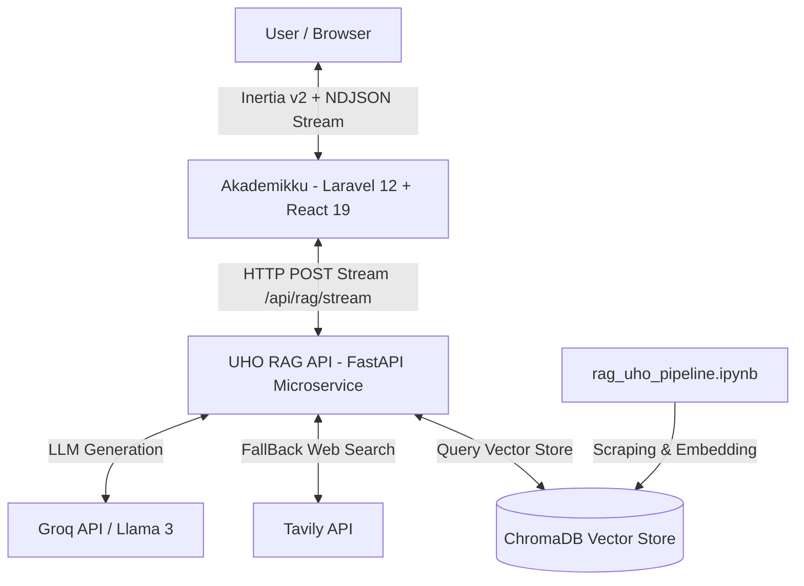

# 🎓 Akademikku RAG UHO Chatbot

> Monorepo Chatbot Akademik Universitas Halu Oleo (UHO) berbasis **Retrieval-Augmented Generation (RAG)**. Mengintegrasikan aplikasi web Laravel 12 + React 19 Inertia v2 dengan Microservice Python FastAPI RAG (LangChain + ChromaDB + Groq + Tavily).

---

## 📌 Arsitektur Sistem

Monorepo ini terdiri dari 3 komponen utama:



| Komponen | Teknologi | Deskripsi |
| :--- | :--- | :--- |
| **`akademikku/`** | Laravel 12, React 19, Inertia.js v2, Vite, TailwindCSS v4 | Aplikasi web utama penangan autentikasi, manajemen chat history, dan UI streaming real-time |
| **`uho_rag_api/`** | FastAPI, Python 3.10+, LangChain, ChromaDB, Groq LLM | Microservice RAG penanggung jawab ekstraksi konteks akademik UHO & streaming NDJSON |
| **`rag_uho_pipeline.ipynb`** | Jupyter Notebook, Python | Pipeline ekstraksi data PDF/Scraping web UHO & pembentukan Vector Store ChromaDB |

---

## ✨ Fitur Utama

- **🤖 RAG Chatbot Akademik**: Jawaban chatbot dipandu langsung oleh dokumen peraturan & informasi akademik UHO dari Vector Store.
- **⚡ Real-time NDJSON Streaming**: Respon teks mengalir secara real-time ke UI React tanpa lag.
- **🔍 Fallback Web Search**: Jika informasi di Vector Store kurang lengkap, sistem otomatis melengkapi dengan Tavily Live Web Search.
- **📚 Sumber Referensi (Citations)**: Menampilkan sumber asal dokumen (PDF/URL Web) yang digunakan LLM untuk menjawab.
- **🏫 Filter Fakultas & Riwayat Context**: Mendukung penyaringan dokumen berdasarkan fakultas serta konteks riwayat percakapan.
- **🎨 Modern Responsive UI**: Antarmuka berbasis React 19, Radix UI, Framer Motion, dan TailwindCSS v4 (Dark/Light mode).

---

## 📂 Struktur Direktori Monorepo

```
akedmikku-rag-uho/
├── akademikku/                 # Aplikasi Web Utama (Laravel 12 + React 19)
│   ├── app/                    # Controller, Models, & Logic Laravel
│   ├── resources/js/           # Component, Page, & Hook React Inertia
│   ├── routes/                 # Routing Laravel (web.php, auth.php, dll)
│   └── composer.json / package.json
├── uho_rag_api/                # Microservice RAG (FastAPI)
│   ├── main.py                 # Endpoint FastAPI (/api/rag/stream, /health)
│   ├── rag_engine.py           # Logika RAG LangChain, ChromaDB, & Tavily
│   ├── schemas.py              # Schema request/response Pydantic
│   └── requirements.txt        # Dependensi Python
├── rag_uho_pipeline.ipynb      # Notebook Data Scraping & Vector Indexing
├── .gitignore                  # Root gitignore monorepo
└── README.md                   # Dokumentasi proyek
```

---

## 🛠️ Panduan Instalasi & Persyaratan

### Persyaratan Sistem
- **PHP** >= 8.4
- **Composer** >= 2.x
- **Node.js** >= 20.x atau **Bun**
- **Python** >= 3.10
- **Database**: SQLite / MySQL / PostgreSQL

---

### 1. Setup Microservice Python (`uho_rag_api`)

1. Masuk ke direktori `uho_rag_api`:
   ```bash
   cd uho_rag_api
   ```
2. Buat & aktifkan virtual environment:
   ```bash
   # Windows (PowerShell)
   python -m venv .venv
   .\.venv\Scripts\Activate.ps1

   # Linux/macOS
   python3 -m venv .venv
   source .venv/bin/activate
   ```
3. Install dependensi:
   ```bash
   pip install -r requirements.txt
   ```
4. Konfigurasi file `.env`:
   ```bash
   cp .env.example .env
   ```
   Isi API Key pada `.env`:
   ```env
   GROQ_API_KEY=gsk_your_groq_api_key_here
   TAVILY_API_KEY=tvly-your_tavily_api_key_here
   CHROMA_DIR=./chroma_db_akademik
   EMBEDDING_MODEL=sentence-transformers/all-MiniLM-L6-v2
   INTERNAL_API_KEY=your_shared_secret_key
   ```
5. Pastikan folder vector database `chroma_db_akademik/` (hasil dari notebook `rag_uho_pipeline.ipynb`) diletakkan di dalam `uho_rag_api/`.

6. Jalankan server FastAPI:
   ```bash
   uvicorn main:app --host 0.0.0.0 --port 8001 --reload
   ```

---

### 2. Setup Aplikasi Web Laravel (`akademikku`)

1. Masuk ke direktori `akademikku`:
   ```bash
   cd ../akademikku
   ```
2. Install dependensi PHP & Node:
   ```bash
   composer install
   npm install
   ```
3. Konfigurasi `.env` Laravel:
   ```bash
   cp .env.example .env
   php artisan key:generate
   ```
4. Tambahkan konfigurasi integrasi RAG API di `.env` Laravel:
   ```env
   RAG_API_URL=http://localhost:8001
   RAG_API_KEY=your_shared_secret_key
   ```
5. Jalankan migrasi database:
   ```bash
   php artisan migrate
   ```
6. Jalankan server pengembangan (Laravel + Vite):
   ```bash
   composer run dev
   ```

---

## 🚀 Jalankan Aplikasi

Setelah kedua bagian terkonfigurasi:

1. **Jalankan FastAPI Microservice** (Port 8001):
   ```bash
   cd uho_rag_api
   uvicorn main:app --port 8001 --reload
   ```
2. **Jalankan Aplikasi Web Laravel** (Port 8000 & Vite):
   ```bash
   cd akademikku
   composer run dev
   ```
3. Buka browser di `http://localhost:8000`.

---

## 🐳 Jalankan via Docker & Docker Compose

Proyek ini dilengkapi dengan konfigurasi **Docker** dan **Docker Compose** lengkap untuk deployment cepat:

1. **Salin environment file**:
   ```bash
   cp .env.example .env
   ```
2. **Isi API Key pada file `.env`**:
   - `GROQ_API_KEY`
   - `TAVILY_API_KEY` (opsional)
   - `APP_KEY` (dapat dibuat dengan `php artisan key:generate --show` dari folder `akademikku`)

3. **Jalankan container**:
   ```bash
   docker compose up --build -d
   ```

4. **Akses aplikasi**:
   - Web App (Laravel + React): `http://localhost:8000`
   - Python RAG Microservice: `http://localhost:8001/health`

---


## 📡 API Contract (`uho_rag_api`)

### Endpoint Status
- **`GET /health`**
  - Response: `{"status": "ok"}`

### Endpoint Stream RAG
- **`POST /api/rag/stream`**
  - **Headers**:
    - `Content-Type: application/json`
    - `X-Internal-Api-Key: <INTERNAL_API_KEY>`
  - **Body Payload**:
    ```json
    {
      "message": "Apa saja syarat pengajuan cuti akademik di UHO?",
      "model": "openai/gpt-oss-20b",
      "history": [
        {"role": "user", "content": "Halo"},
        {"role": "assistant", "content": "Halo! Ada yang bisa dibantu mengenai UHO?"}
      ],
      "fakultas": "FMIPA"
    }
    ```
  - **Response (NDJSON Streaming)**:
    ```json
    {"eventType": "text_delta", "content": "Syarat pengajuan cuti akademik..."}
    {"eventType": "sources", "content": [{"title": "Panduan Akademik UHO", "source": "https://uho.ac.id/panduan", "asal": "vector_store"}]}
    ```

---

## 📄 Lisensi & Kontributor

- **Pengembang**: [zikrifikri21](https://github.com/zikrifikri21)
- **Lisensi**: MIT License
